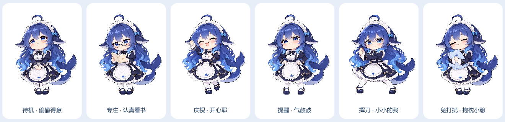
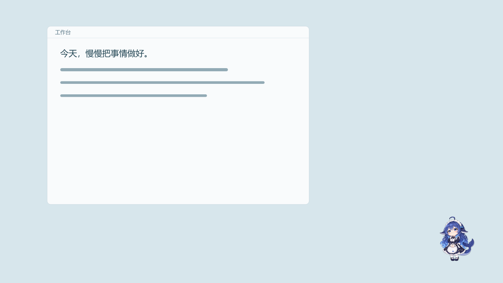
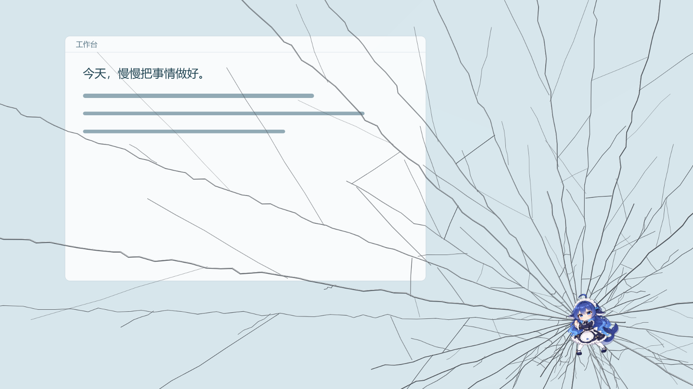

# DeskBuddy · AI 桌面宠物

一个真正住在 Windows 桌面上的宠物：透明、无边框、始终置顶，**任务栏与托盘都能找回**。它帮你记任务、盯专注时间、到点提醒你休息，在你拖延时会举着比身体还大的刀跳出来，**特效铺满整个屏幕**。



**V1.3 · 纯本地运行 · 不需要任何大模型 API**

**下载体验**：[Windows 免安装版与完整提交材料](https://github.com/kingofbuilding/deskbuddy/releases/tag/v1.3.0)。完整解压后运行 `DeskBuddy.exe`；本机普通启动未通过，可使用包内的兼容启动入口。

图文教程和创作说明位于 [submission](submission/README.md)，运行包与压缩附件在 Release 中下载。运行包无需 Node.js；源码开发方式见下文。

### 自然桌面与本体演出

- **只留下角色**：没有底板、边框、矩形阴影或光晕；角色外的透明像素可以直接点击桌面。倒计时在鼠标移到角色时显示。
- **同一只鱼鱼完成动作**：日常关怀由原来的桌宠走过来；砍刀跟随它的双手，裂纹从它出拳的位置产生。全屏层只绘制刀、裂纹和彩纸，没有第二份角色或提醒海报。
- **随时找回**：普通窗口「鱼鱼桌宠」单独承载蓝鲸任务栏入口，日常保持最小化。点击任务栏图标会唤醒鱼鱼并打开小控制台；关闭控制台只会最小化。托盘单击、**Ctrl+Alt+P**、桌面快捷方式和设置找回按钮也可复原大小位置。
- **贴边与菜单退场**：拖动按角色不透明轮廓限制位置，透明留白可以超出屏幕，不再把角色挡在边缘几厘米外。菜单或气泡展开时临时向屏内避让，收起后返回；菜单支持「收起」、再次点击、Esc、移开鼠标 0.45 秒、失焦或 10 秒超时关闭。
- **独立找回入口**：首次启动在桌面新增「找回鱼鱼桌宠」快捷方式，双击即可恢复；它使用当前数据目录，避免意外启动另一份空白任务清单。修复了拖动时的时钟命名冲突，并为鼠标穿透转发中断增加原生命中刷新。
- **软萌聊天气泡**：奶白底、淡蓝描边和圆润小尾巴，像从鱼鱼头顶冒出来；提醒、按钮与聊天窗口都去掉投影。陪伴窗口的回复也放在头像上方，使用同一套浅色样式。



### 主动陪伴更新


- **全桌面游走**：平时眨眼、歪头、打招呼；娱乐、空闲一分钟或任务清空后，每隔约一两分钟在所有显示器的桌面可用区域随机走三个落点，再回到用户放置的位置。移动距离不再限制为左右 160 像素；开始专注、恢复工作、出现提醒或拖动会打断。
- **按实际使用时间关心你**：默认累计 30 分钟活动后提醒喝水，连续 50 分钟使用后提醒起身。离开三分钟或长时间休眠后，久坐计时重新开始；喝水可选「喝过啦 / 等会儿喝」。
- **自动砍刀与裂屏**：在设置中开启娱乐督促，配置娱乐应用。默认连续娱乐 10 分钟且清单未完成时，原本的鱼鱼走到屏幕前，再交替挥动四十米砍刀或出拳裂屏；默认冷却 15 分钟。可单独关闭自动特效，保留气泡督促。
- **完成就撒花**：每勾选完成一项任务，鱼鱼就跳起来撒花；全清时给出全部完成的庆祝。取消勾选不会撒花。
- **有互动的催任务**：「好，先做任务」会绑定清单第一条开始专注；「这局打完」暂缓五分钟；可点击收起或关闭娱乐窗口。来访约 12 秒后回原位，Esc 可提前让它退回去，忽略的气泡也会自动退场。
- **窗口操作**：最小化是可恢复的；真正关闭需要点按钮并确认，发送正常关闭消息，让程序自己的保存提示仍能显示。不会强制杀进程。
- **使用入口**：右键宠物 → 设置，打开「游戏与娱乐督促」；可演示递水、抓任务和打招呼。把浏览器加入名单后，工作网页也会被当作娱乐窗口。

新增源素材与提示词见 [life-animation-prompts.json](docs/life-animation-prompts.json)，使用内置 imagegen 生成。`npm run preview:life` 可重新编码日常动作预览。

### 提醒到底怎样触发

- 专注倒计时结束后给出专注提醒；累计活动 30 分钟提醒喝水，连续使用 50 分钟提醒休息，均可在设置调整。
- 娱乐督促默认关闭，自动特效子开关默认开启。开启督促后每 5 秒读取本机前台进程名；有未完成任务、连续匹配同一娱乐应用满 10 分钟，且不在免打扰、现有提醒或冷却期时，鱼鱼走到面前并交替出招，默认冷却 15 分钟。
- 不查看屏幕、视频画面、网页正文或窗口标题。默认名单包含游戏及 VLC、MPV、PotPlayer 等播放器；在名单中的前台播放器即使不碰键鼠也累计观看时长，暂停播放仍会算。锁屏、休眠不计时，也不演出。浏览器不默认加入；手动加入后所有网页都会按娱乐处理，无法区分学习视频和娱乐视频。
- 菜单里的砍刀、裂屏仍可手动预览。自动出招会在走到面前后播放，同一提醒只播放一次；切回工作应用、完成任务、免打扰或收起提醒会中断。可选自动最小化匹配窗口，正常关闭仍需按钮确认。


---

## ⭐ 两个招牌特性

**真实裂屏与四十米砍刀**：裂屏只显示透明玻璃断口、撞击点、暗缝和细微反光，不含字幕、角色和漫画背景。砍刀是独立的超长钢刃，长达两屏半，由右下角小小的鲸鱼娘握住挥动。任务全清时仍有礼花庆祝。

**真·常驻**：收起或关闭宠物窗口会最小化到任务栏，托盘同时保留入口。Ctrl+Alt+P 可恢复大小和位置；选择「退出」才会真正结束。关机重启后任务和专注倒计时都还在。

---

## 一、它能做什么

| 能力 | 说明 |
|---|---|
| 🐾 桌面悬浮宠物 | 透明背景、无边框、始终置顶、可拖动，二次元鲸鱼娘造型 |
| 🏠 任务栏与托盘 | 收起后保留任务栏；托盘可找回大小位置、开面板、演示特效、退出 |
| 🎭 六种宠物状态 | 待机 / 专注 / 提醒（生气）/ 庆祝（开心）/ 陪伴 / 免打扰，各有独立形象与果冻动画 |
| ✅ 每日任务 | 添加、勾选完成、删除；区分「待完成 / 已完成」；显示创建时间与截止时间 |
| ⏱ 专注计时 | 开始 / 暂停 / 继续 / 结束；默认 25 分钟可调；基于绝对结束时间，不漂移 |
| 🔔 主动提醒 | 专注结束自动弹出提醒，提供「我完成了 / 再专注一会儿 / 稍后提醒 / 先休息」 |
| ☕ 休息提醒 | 默认 50 分钟可调；「已休息 / 10 分钟后提醒 / 今天不再提醒」 |
| 🌙 免打扰 | 暂停一切普通主动提醒与音效，用户主动操作仍然响应 |
| 🗡 四十米大砍刀 | 超长钢刃、真实金属明暗、小角色握刀蓄力与挥砍，约 3.8 秒 |
| 💥 真实玻璃裂屏 | 透明桌面上的细密裂缝、撞击点、玻璃暗缝与反光，无字幕与漫画背景，约 4.2 秒 |
| 🎉 庆祝特效 | 每完成一项任务，原本桌宠跳起来撒花，彩纸从手边飞出；全部完成时额外庆祝 |
| 💾 本地保存 | 任务、设置、计时状态、统计写入应用专属数据目录，原子写入 |
| 🖥 系统托盘 | 显示/隐藏、打开各面板、重置窗口位置、打开数据目录、退出 |

### 本次视觉更新 · 二次元鲸鱼娘与真实特效

- **角色依据网上参考重做**：蓝色渐变长发、鲸鳍、鲸尾、深蓝白女仆裙、圆脸腮红。六种状态使用同一角色的透明 PNG 插画。
- **裂屏**：只叠加玻璃损伤，保留真实桌面，去掉文字、人物、放射线和蓝色发光。径向断口、随机分叉、撞击点碎屑和细微反光同时生成，4.2 秒自动退场。
- **四十米砍刀**：刀身 260vmax，超出屏幕边界，角色仍保持桌宠大小；单独绘制钢刃、刀背、刀锋和握柄，3.8 秒完成蓄力、挥下和回收。
- **到点提醒**：原本桌宠通过走位、挥手和小气泡提醒；关闭动画或打开免打扰时遵守现有设置。
- **预览入口**：单击宠物查看菜单，或从托盘的「演示全屏特效」选择。所有覆盖层点击穿透、不抢焦点、自动清理。
- **素材与复现**：`npm run icons` 检查六张 PNG 并生成图标与预览；`npm run preview` 导出特效截图并检查玻璃透明度、刀身比例和清理。在线参考与生成提示词见 [character-art.md](docs/character-art.md)。




### 隐私与窗口操作范围

- 不读取网页正文、窗口标题或聊天内容；不记录键盘内容、不录屏、不持续截屏，不上传数据。
- 开启娱乐督促后，只在本机读取前台进程名、PID 和窗口句柄，按用户的娱乐应用名单匹配；目标信息仅在内存中短暂保留。
- 健康计时只使用系统空闲秒数。应用关闭期间不累计工作时间，也不补发一串过期关怀。
- 只对匹配的娱乐窗口提供最小化；关闭必须由用户点击并确认，操作前重新验证窗口所属进程。
- 不伪造系统崩溃或系统错误；不接入大模型、账号和云同步。

---

## 二、环境要求

| 项目 | 要求 |
|---|---|
| 操作系统 | Windows 10 / Windows 11（64 位） |
| Node.js | ≥ 20.19（jsdom 测试依赖要求） |
| npm | ≥ 9 |
| 磁盘 | 约 400 MB（主要为 Electron 运行时） |

项目已锁定 Electron `40.10.2`，不需要全局安装 Electron。

---

## 三、安装与启动

```bash
# 1. 安装依赖（国内网络可加 --registry=https://registry.npmmirror.com）
npm install

# 2. 启动应用
npm start
```

启动后会看到右下角出现一只蓝发、女仆裙造型的二次元鲸鱼娘。

> **如果 `npm install` 卡在下载 Electron 二进制**：
> 设置镜像后重试即可：
> ```bash
> npm config set electron_mirror https://npmmirror.com/mirrors/electron/
> npm install
> ```

### 常用命令

| 命令 | 作用 |
|---|---|
| `npm start` | 正常启动 |
| `npm run dev` | 开发模式（面板失焦不自动隐藏、可开 DevTools） |
| `npm test` | 单元 + 集成测试（134 个用例） |
| `npm run smoke` | 应用自检：真实启动窗口，逐项检查并截图 |
| `npm run verify` | **一键验收**：跑完所有测试与端到端流程，生成验收报告 |
| `npm run test:e2e` | 只跑真实 Electron 端到端流程 |
| `npm run icons` | 由 PNG 源素材重新生成图标与预览图 |

---

## 四、怎么玩

### 鼠标操作

| 操作 | 效果 |
|---|---|
| **单击** 宠物 | 弹出快捷菜单 |
| **双击** 宠物 | 直接打开任务面板 |
| **右键** 宠物 | 打开设置面板 |
| **按住拖动** 宠物 | 移动位置（自动夹在屏幕内，重启后记住） |
| **收起 / 关闭** 宠物窗口 | 最小化到任务栏，点击任务栏图标恢复 |
| **Ctrl+Alt+P** | 找回桌宠，恢复正常大小和默认位置 |
| **Esc** | 关闭菜单 / 面板 |

### 快捷菜单

今日任务 · 开始专注 · 陪伴模式 · 设置与休息 · **抓到你了（砍刀）** · **裂屏特效** · 免打扰开关 · 收起到任务栏 · 退出

### 一次完整的使用流程

1. 双击宠物 → 在输入框写「完成 API 调用模块」→ 回车
2. 点「开始专注」，默认 25 分钟，宠物切换为戴眼镜看书的专注形象，头顶出现倒计时
3. 倒计时结束 → 宠物跳起来冒气泡：「专注时间结束啦，要不要检查一下进度？」
4. 点「我完成了」→ 如果这一轮没有绑定任务，会问你「哪件事完成了？」，选一条替你划掉
5. 任务全部完成 → **彩纸**从宠物手边泼洒，宠物跳起来撒花：「全部完成！今天的你值得一朵小红花。」

### 演示要点（30 秒版）

1. **透明悬浮**：把记事本拖到宠物后面，宠物浮在上面，背景完全透明
2. **全屏砍刀**：托盘右键 → 演示全屏特效 → 斩！！——原本桌宠蓄力挥动远大于身体的钢刃，刀柄随双手移动
3. **全屏裂屏**：同上选裂屏——细密玻璃断口从撞击点向边缘扩散，真实桌面始终透过裂纹显示；强调「点击穿透，鼠标完全不受影响」
4. **找回**：收起宠物 → 点击任务栏图标恢复；缩小后按 Ctrl+Alt+P，大小与位置复原
5. **提醒**：把专注时长改成 5 分钟，或用设置里的休息间隔演示

---

## 五、数据与隐私

数据保存在 Electron 的 `userData` 目录（设置面板底部有完整路径，点「打开」直达）：

```
%APPDATA%\DeskBuddy\        （打包版）
%APPDATA%\Electron\         （开发模式，应用名未打包时）
├── tasks.json      任务列表
├── settings.json   用户设置
└── session.json    计时状态与统计
```

- 每个文件都带 `version` / `kind` / `savedAt` 外壳，便于将来迁移
- **原子写入**（写临时文件 → `fsync` → `rename`），断电不会写出半截 JSON
- JSON 损坏时：自动备份为 `*.corrupt-<时间戳>.json`，回退默认值，并在界面提示
- 写入失败时：界面弹出可见的「保存失败」提示，并自动重试一次，绝不静默丢数据
- **不收集**：键盘输入、浏览历史、截图、窗口标题和聊天内容。娱乐督促只在开启后于本机读取当前前台进程名与窗口标识，不写入会话文件

---

## 六、安全设计

对应 PRD 4.4 的要求，逐条落实：

| 要求 | 实现 |
|---|---|
| 开启 `contextIsolation` | ✅ 所有窗口 `contextIsolation: true` |
| 禁用不必要的 Node 集成 | ✅ `nodeIntegration: false`、`nodeIntegrationInWorker/SubFrames: false` |
| 渲染进程通过受限 preload | ✅ 只暴露 `window.deskbuddy` 上显式列出的函数 |
| 只开放存储、窗口控制等必要接口 | ✅ 白名单式 IPC，通道数量固定 |
| 不允许执行任意系统命令 | ✅ 不接受用户命令文本；主进程仅启动固定的 Windows 窗口助手，通过白名单 JSON 指令通信 |
| 不把文件访问能力暴露给页面 | ✅ 渲染进程完全无 `fs`；只能通过固定 3 个保存接口写固定文件 |
| 额外加固 | `sandbox: true`、导航白名单、`window.open` 一律拒绝、外链走系统浏览器、CSP 限制脚本来源 |

渲染进程的 CSP：

```
default-src 'none'; script-src 'self'; style-src 'self' 'unsafe-inline';
img-src 'self' data:; connect-src 'none'; object-src 'none';
```

即：不允许任何远程请求，页面脚本只能加载本地文件。

---

## 七、项目结构

```
DeskBuddy/
├── package.json
├── README.md
├── .gitignore
├── src/
│   ├── main/                     # 主进程（唯一能碰文件系统的地方）
│   │   ├── main.js               # 生命周期、托盘、IPC 校验、单实例
│   │   ├── pet-window.js         # 窗口创建、置顶、位置夹取
│   │   ├── storage.js            # 原子写入、损坏恢复
│   │   └── selftest.js           # 应用内自检（npm run smoke）
│   ├── preload/
│   │   └── preload.js            # 唯一的桥，白名单接口
│   └── renderer/                 # 界面 + 业务逻辑
│       ├── index.html
│       ├── styles.css
│       ├── app.js                # 控制器：接线、tick、副作用
│       ├── ui.js                 # 宠物窗口渲染
│       ├── panels.js             # 任务/专注/设置/陪伴面板渲染
│       ├── effects.js            # 砍刀 / 裂屏 / 撒花
│       ├── audio.js              # WebAudio 合成音效（无音频文件）
│       ├── core/                 # 纯逻辑，可在 Node 里直接测试
│       │   ├── util.js
│       │   ├── settings.js
│       │   ├── tasks.js
│       │   ├── timers.js         # 基于绝对时间的计时引擎
│       │   ├── pet-state.js      # 带优先级与独占锁的状态机
│       │   ├── reminder-queue.js # 防轰炸队列
│       │   ├── copy.js           # 台词库
│       │   ├── stats.js          # 聚合统计
│       │   └── app-state.js      # reducer：唯一的状态变更入口
│       └── assets/               # 6 张鲸鱼娘 PNG + 巨型刀 SVG + 图标
├── test/                         # node:test + jsdom
├── scripts/                      # 自检、端到端、图标生成、验收
└── docs/
    ├── acceptance-report.md      # 自动生成的验收报告
    ├── environment-notes.md      # 环境验证记录
    └── previews/                 # 宠物形象 PNG 预览
```

### 一处必要的架构取舍

PRD 建议的目录里把渲染层拆成 `state.js / tasks.js / timers.js / effects.js`。实际实现中：

- 纯逻辑被收进 `src/renderer/core/`，**不依赖任何 DOM 或 Electron API**，因此可以直接用 `node --test` 测试；
- `effects.js` 保留在渲染根目录（它确实依赖 DOM）；
- 多个窗口共用同一套逻辑，通过 `app.js` 里的两条启动路径（宠物窗口 / 面板窗口）区分。

这样既满足了职责拆分，又让「同一时刻只有一个地方推进计时」成为结构上的保证。

---

## 八、关键实现说明

### 1. 计时为什么不会漂移

不使用「每秒减一」的计数器，而是保存绝对结束时间：

```js
// 开始
focus.endsAt = now + durationMs;

// 任意时刻求剩余
remaining = Math.max(0, focus.endsAt - Date.now());
```

窗口失焦、系统卡顿、甚至切出去半小时，回来时剩余时间依然准确。
应用重启时用同一个 `endsAt` 恢复；休眠期间错过的提醒只补一条，超过 6 小时的直接顺延，不会一次性弹出一堆过期提醒。

### 2. 提醒为什么不会轰炸

三层防护：

1. **单一队列**：`reminder-queue.js` 保证同一时刻只有一个 `active`，同类提醒去重；
2. **最小间隔**：普通提醒之间有 `minReminderGapMinutes`（默认 3 分钟）；
3. **延迟机制**：`availableAt` 时间戳让「稍后提醒」在到点前取不出来，不需要额外计时器。

状态层面再加一层：`pet-state.js` 给 `effect / reminder / celebration` 加了**独占锁**，低优先级请求会被明确拒绝，而不是排队等着打断。

### 3. 状态切换为什么不会打架

所有变更都走 `reduce(state, action)`，返回 `{ state, effects }`。
副作用（放音效、播动画、落盘）以数据形式返回，由控制器统一执行。
于是「哪个计时器先触发」不再影响结果——因为只有一个入口能改状态。

### 4. 特效为什么是安全的（虽然很浮夸）

- 全屏特效运行在一个**独立的透明覆盖层窗口**里：`setIgnoreMouseEvents(true)` 让鼠标完全穿透、`focusable: false` 让它永远不抢焦点、`showInactive()` 静默出现静默消失
- 覆盖层的尺寸 = 所有显示器的联合包围盒，播放前重新对齐，多显示器也铺满
- 裂纹用 SVG path 画、玻璃反光用 CSS 渐变，不调用任何系统 API，不修改壁纸、不伪造系统错误
- 宠物窗口内还有一套小尺寸特效作为兜底：覆盖层万一失败（如特殊显卡环境），窗口内动画照常播放
- 动画结束后自动隐藏覆盖层、清理 DOM 与定时器；应用退出时 `fxOverlay.destroy()`
- 设置里关掉「动画特效」后，窗口内动画与全屏覆盖层都会停

---

## 九、测试与验收

```bash
npm run verify
```

会依次执行并生成 `docs/acceptance-report.md`：

| 层级 | 内容 | 用例数 |
|---|---|---|
| 单元测试 + Reducer 测试 | 工具函数、设置校验、任务模型、计时引擎、状态机、队列、统计、自动特效交替与取消、全桌面游走范围 | 105 |
| 集成测试（jsdom） | 加载真实页面，模拟点击、拖动、菜单退场、表单、本体锚点桥接与覆盖层清理 | 29 |
| 应用自检（真机） | 透明像素比例、置顶、无边框、截图、面板同步、**全屏覆盖层 6 项** | 43 项检查 |
| 端到端 | 重启恢复、专注提醒 → 任务确认、休息防轰炸、主动关怀、本体特效、贴边与任务栏找回、自动出招与游走及完成撒花 | 7 条流程 |

合计 **134 个自动化用例 + 43 项真机检查 + 7 条端到端流程**，全部通过。

最近的验收结果见 [acceptance-report.md](docs/acceptance-report.md)。

---

## 十、已知限制

1. **提供 Windows 免安装运行包，未提供安装向导。** 完整解压后运行 `DeskBuddy.exe`，若当前环境普通启动立即退出，可用包内兼容启动入口。运行包在本机使用兼容参数通过 43 项自检；普通启动在当前工具环境中未通过。执行 `node scripts/package-portable.js` 可从已安装的 Electron 运行时重新组装。
2. **开机启动仅在打包后生效。** 开发模式下注册会把 `electron.exe` 写进启动项，反而添乱，因此代码里显式跳过了。
3. **音效是 WebAudio 合成的。** 好处是仓库里没有二进制音频、不会缺文件；代价是音色比较「电子」，不如真人配音。
4. **宠物使用多帧透明 PNG、CSS 身体动作和窗口走位**，没有骨骼动画系统。这是 PRD 10.2 允许的范围。
5. **娱乐督促按进程文件名匹配。** 不理解网页内容；浏览器加入名单后所有网页都按娱乐处理。独占全屏游戏可能遮住桌宠，窗口或无边框模式更可靠。
6. **多显示器切换**时窗口会夹取到最近的屏内，但不会自动跟随显示器切换。

---

## 十一、后续可以怎么做

第一阶段（本版本）已经把「住进桌面」这件事做完了。下一步按价值排序：

1. **接入大模型**：把 `copy.js` 的固定台词换成 LLM 生成，可以让吐槽更贴合当前任务
2. **任务截止时间 UI**：数据结构已支持 `dueAt`，只差一个时间选择器
3. **周视图与统计图表**：`stats.js` 已经在按天聚合，可直接画趋势
4. **打包与自动更新**：electron-builder + 签名
5. **多宠物皮肤**：形象已经按「状态 → SVG」解耦，加皮肤只需加文件

---

## 十二、许可

MIT


