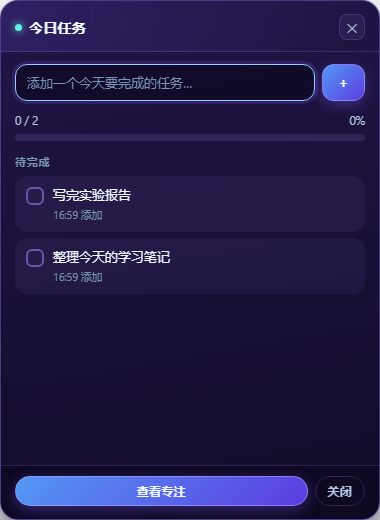
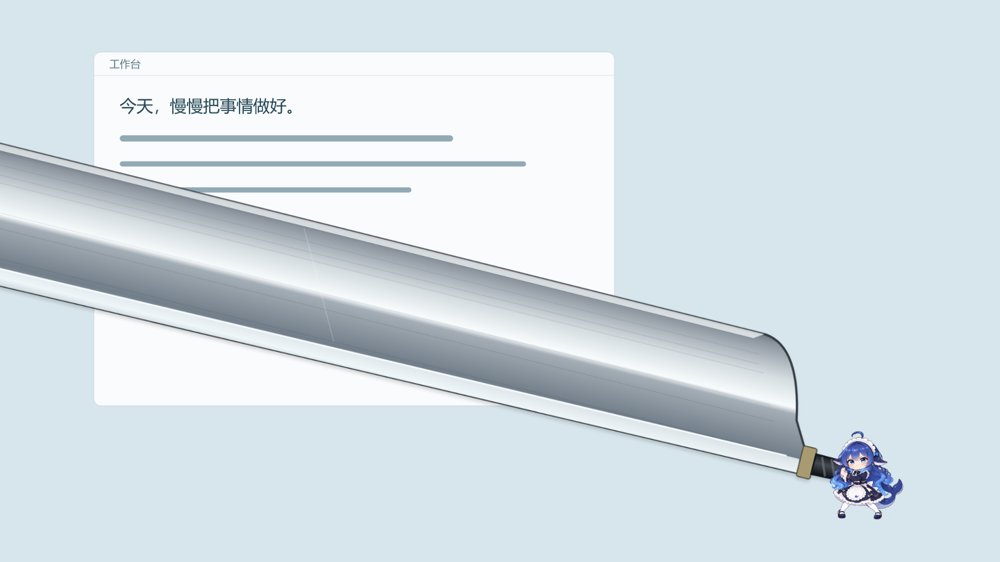

# 我用 AI 做了一只会抓我摸鱼的大肥鱼

明明只想看五分钟视频，回过神来，任务还没动。普通提醒弹出来，我经常顺手关掉。于是我用 AI 编程做了一只住在 Windows 桌面上的鲸鱼娘：平时眨眼、散步，娱乐太久就跑过来，举起一把远远大过自己的砍刀；完成任务，又会高高兴兴地撒花。

它叫 DeskBuddy。这个作品把任务管理、专注计时和桌面陪伴放到同一个角色身上。下面用一次完整体验，介绍它怎么运行、怎么设置，以及那些夸张动作究竟怎样触发。

## 第一步让鱼鱼住进桌面

下载 Windows 免安装运行包，把压缩包完整解压到一个普通文件夹，再双击 DeskBuddy.exe。不用安装 Node.js，也不用填写大模型 API Key。不要只拖出一个 exe，它旁边的资源文件也要保留。
如果普通启动立即退出，可试包内的兼容启动入口。

启动后，鱼鱼会站在桌面上。角色背后没有底板和矩形阴影，透明区域可以点击穿透，不挡住下面的窗口。按住角色可以拖动，角色轮廓能够贴近屏幕可用区域的边缘。鼠标靠近时，它还会挥手打招呼。

如果收起后找不到它，点击任务栏里的鱼鱼入口，或者按 Ctrl+Alt+P，就能恢复正常大小和位置。快捷菜单带有收起按钮；移开鼠标、按 Esc 或切换窗口，也能让菜单退场。

## 第二步先写一件真正要做的事

双击鱼鱼打开任务面板，输入一个具体任务，比如写完实验报告。与其写一个很大的愿望，不如先写下接下来能完成的一步。添加后，可以直接开始一轮专注计时，默认时长是 25 分钟，也可以在设置里调整。

计时结束，鱼鱼会用头顶的小气泡提醒你检查进度，可以选择完成、继续专注、稍后提醒或先休息。它还会按活动时长提醒喝水和起身，默认分别为 30 分钟和 50 分钟。打开免打扰后，普通主动提醒会暂停。

## 第三步给鱼鱼一张娱乐应用名单

右键鱼鱼进入设置，开启游戏与娱乐督促，再开启自动砍刀与裂屏。名单里填写应用的进程文件名，例如 cs2.exe、vlc.exe 或 potplayermini64.exe。可以调整连续娱乐多久提醒；新配置默认 10 分钟，也能改成 3 分钟体验。

它每隔 5 秒检查当前前台应用的进程名。如果名单中的同一应用持续处于前台、清单还有任务没完成，而且没有其他提醒或冷却限制，鱼鱼就会走到面前。等本体走到位置，才开始挥刀或出拳，两个动作轮流出现，默认冷却 15 分钟。

这里需要说清楚：它没有读屏，也不理解视频内容。把 Chrome 或 Edge 加进名单后，浏览器里的学习网页同样会计时；播放器停在前台但暂停播放，也会算。锁屏和休眠不累计娱乐时长。这样的规则比较直接，适合由自己配置督促范围。

## 第四步看看小角色怎样挥动大砍刀

四十米砍刀的看点是反差：鱼鱼还是桌宠大小，钢刃却长到超出屏幕。刀柄跟随本体双手移动，本体负责蓄力、挥下和回收。裂屏则从它出拳的位置生成细密断口、暗缝和微弱反光，不靠大字字幕说明自己正在砸屏幕。

全屏层只绘制刀、玻璃裂纹和彩纸，原本那只鱼鱼继续完成动作，不会再出现一张放大的角色海报。覆盖层点击穿透，演出结束会自动清理。点击这局打完、切回工作应用或开启免打扰，也会中断相应的自动演出。

## 第五步做完任务让它给你撒花

在任务面板勾选完成一项，鱼鱼就会跳起来撒花；整张清单做完，还有全部完成的庆祝。取消勾选不会触发奖励。比起只改变一个勾选框，我更希望用户能收到角色给出的回应，让完成一件小事也有一点仪式感。

不在专注、正在娱乐或空闲时，鱼鱼还会在整个桌面的可用区域选择几个落点散步，再回到你放置的位置。开始专注后它会回家，恢复工作、出现提醒或拖动角色，也能打断游走。

## 这次 AI 帮我完成了什么

开发中，我使用 Codex 辅助编写 Electron 窗口、任务状态机、计时和自动督促逻辑，用内置 imagegen 生成角色的透明状态图与动作帧。真正花时间的是把可爱的图变成能用的桌宠：修掉隐藏面板漏出的阴影，让拖动边界贴着角色轮廓，再补上任务栏找回和菜单退场。

当前版本通过了 134 个自动化用例、43 项应用检查和 7 条端到端流程。它运行时使用本地规则和台词，没有接入大模型聊天，也不会自动理解网页内容。我想展示的是，AI 辅助编程可以把一个有趣的陪伴想法，做成能运行、能设置、也能验证的小工具。

图示说明：任务面板和关怀气泡为程序截图；桌面、砍刀和裂屏图使用示例工作台背景展示真实角色及特效层，不包含个人桌面内容。角色造型受 DeepSeek 鲸鱼娘二创启发，本作品非官方作品。
